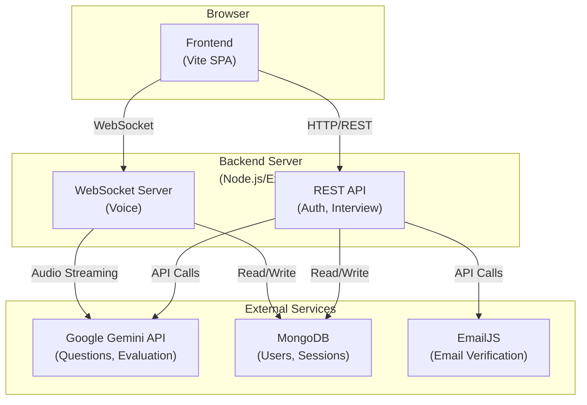
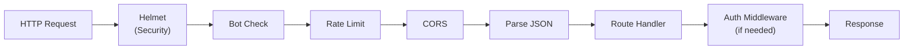
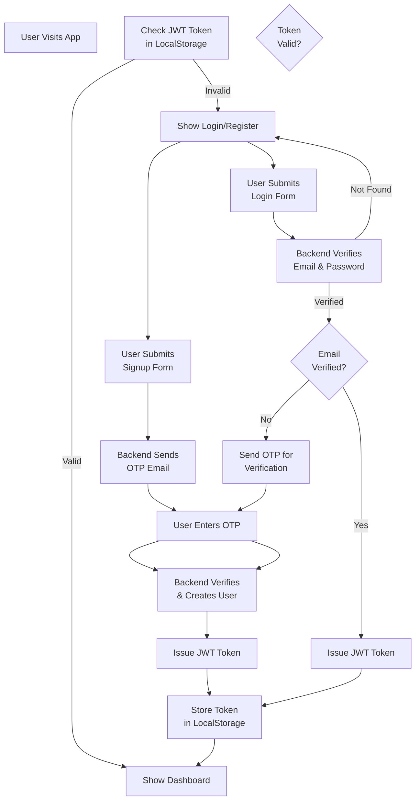
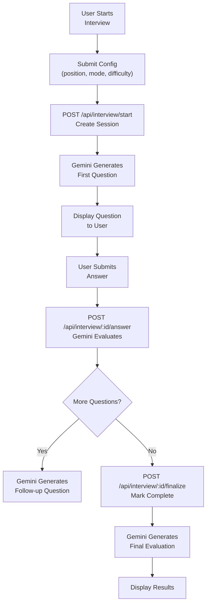
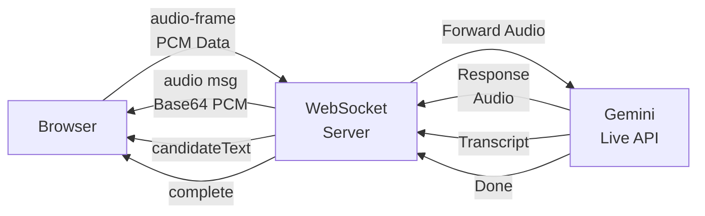
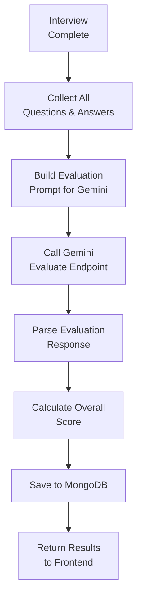
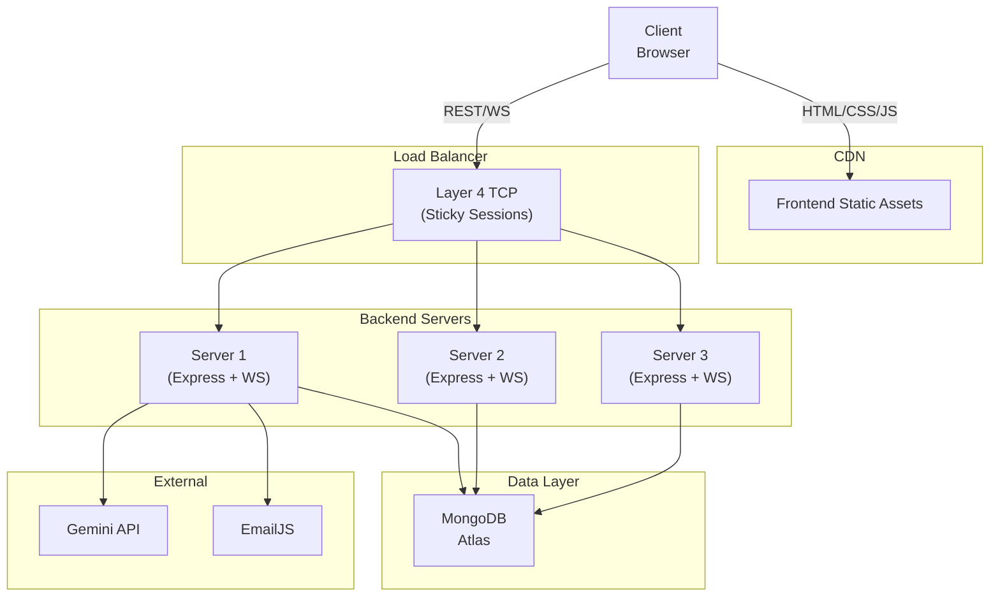

# Architecture

This document describes the system design, major components, data flows, and architectural decisions behind the AI Interviewer.

## System Overview

AI Interviewer is a distributed system with three main layers:

1. **Frontend** - Browser-based user interface built with Vite
2. **Backend** - Node.js/Express REST API and WebSocket server
3. **External Services** - Google Gemini API, MongoDB, EmailJS



## Component Architecture

### Frontend (`/frontend/public`)

**Technology**: Vanilla JavaScript, HTML, Vite (build tool only)

**Pages**:
- `index.html` - Home/login page
- `login.html` - User login form
- `register.html` - User registration form
- `interview.html` - Interview interface (text and voice)
- `results.html` - Results and evaluation display

**JavaScript Modules** (`/frontend/public/js/`):
- `auth.js` - Authentication logic and token management
- `authform.js` - Form handling for login/registration
- `interview.js` - Interview UI state and logic
- `audio.js` - Audio recording and playback
- `setup.js` - Interview configuration
- `results.js` - Results display logic
- `charts.js` - Score visualization
- `common.js` - Shared utilities and API helpers
- `pcm.js` - PCM audio encoding/decoding

**Static Assets**:
- `css/` - Stylesheets
- `images/` - Images and icons
- `worklets/` - Web Audio worklets for real-time processing

### Backend (`/backend`)

**Technology**: Node.js, Express 5.2.1

#### Core Structure

```
backend/
├── index.js                 # Express app setup, middleware, routes
├── config.js               # Environment configuration
├── db.js                   # MongoDB connection and utilities
├── routes/
│   ├── auth.js            # Authentication endpoints
│   └── interview.js        # Interview endpoints
├── auth/
│   ├── middleware.js       # JWT verification middleware
│   ├── token.js            # JWT signing/verification
│   ├── passwords.js        # Password hashing/verification
│   └── email.js            # Email sending (EmailJS)
├── interview/
│   ├── engine.js           # Session lifecycle and evaluation
│   ├── store.js            # Session persistence
│   └── prompts.js          # Prompts for Gemini
├── gemini/
│   ├── client.js           # Gemini API client (text questions)
│   └── live.js             # Gemini Live API client (voice)
├── cache/
│   └── questions.js        # Question caching logic
├── models/
│   ├── User.js             # User schema
│   ├── Session.js          # Interview session schema
│   └── Question.js         # Question schema
└── assets/
    └── interview-complete.pcm  # Closing chime audio
```

#### Middleware Stack

Applied in order (from `index.js`):

1. **Helmet** - Security headers (CSP, XSS protection, etc.)
2. **Bot Detection** - Blocks scrapers and automated tools
3. **Rate Limiting** - Global API limiter (100 req/15 min per IP)
4. **CORS** - Allow frontend origin only
5. **JSON Parser** - Parse request bodies
6. **Static Files** - Serve frontend build
7. **Route Handlers** - Auth and interview routes

#### Request Flow



### External Services

#### Google Gemini API

**Two usage patterns**:

1. **Text Model** (gemini-3.6-flash)
   - Generates interview questions
   - Evaluates text answers
   - Called via REST API

2. **Live Model** (gemini-2.5-flash-native-audio-latest)
   - Conducts real-time voice interviews
   - Processes audio streams
   - Streams response audio back
   - Called via WebSocket (in `backend/gemini/live.js`)

#### MongoDB

**Optional but recommended**. Without it:
- User accounts disabled (503 errors on auth endpoints)
- Interview history not saved
- Voice interviews still work (in-memory sessions)

**Collections**:
- `users` - User accounts, email verification, password reset
- `interviewsessions` - Interview sessions, questions, answers, evaluations
- `questions` - Question cache

**Indices** (from source code):
- `User`: `email` (unique)
- `InterviewSession`: `user` + `createdAt` (for listing user's sessions)
- `Question`: `position` + `customPosition` + `interviewType` + `difficulty`

#### EmailJS

**Optional**. Used for:
- Email verification OTPs during signup
- Password reset codes

**In development mode**: Codes are logged to console instead of sent via email (if EmailJS not configured).

## Data Flow Patterns

### Authentication Flow



### Text Interview Flow



### Voice Interview Flow

```mermaid
graph TD
    Start["User Starts<br/>Voice Interview"]
    CreateSess["POST /api/interview/start<br/>(mode: voice)"]
    GetToken["Get JWT Token"]
    
    Connect["WebSocket Connect<br/>/live/:interviewId?token=X"]
    Init["Initialize Gemini<br/>Live Session"]
    StartMsg["Gemini Sends<br/>Opening Message"]
    PlayAudio["Browser Plays<br/>Audio"]
    
    Record["User Speaks"]
    SendAudio["Browser Sends<br/>PCM Audio Frames"]
    GeminiRecv["Gemini Receives<br/>& Transcribes"]
    GetResp["Gemini Generates<br/>Response"]
    SendResp["Send Response<br/>Audio & Text"]
    PlayResp["Browser Plays<br/>& Displays"]
    
    ContinueLoop{Continue<br/>Recording?}
    Record
    
    Done["Interview Complete<br/>Threshold Reached"]
    Complete["Send Complete<br/>Message"]
    Eval["Backend Evaluates<br/>All Answers"]
    ShowResults["Display Results"]
    
    Start --> CreateSess
    CreateSess --> GetToken
    GetToken --> Connect
    Connect --> Init
    Init --> StartMsg
    StartMsg --> PlayAudio
    PlayAudio --> Record
    Record --> SendAudio
    SendAudio --> GeminiRecv
    GeminiRecv --> GetResp
    GetResp --> SendResp
    SendResp --> PlayResp
    PlayResp --> ContinueLoop
    ContinueLoop -->|Yes| Record
    ContinueLoop -->|No| Done
    Done --> Complete
    Complete --> Eval
    Eval --> ShowResults
```



### WebSocket Message Flow



### Evaluation Flow



## Authentication & Authorization

### JWT Token

**Format**: Standard JWT with header, payload, claims

**Payload contains**:
- `sub` - User ID
- `email` - User email
- `iat` - Issued at
- `exp` - Expiration (typically 7 days)

**Storage**: LocalStorage on client (accessible via `Authorization: Bearer <token>` header)

**Middleware** (`backend/auth/middleware.js`):
- `requireAuth` - Validates token, attaches user to `req.user`
- `optionalAuth` - Attempts validation, doesn't fail if invalid

### Rate Limiting

Applied at multiple levels:

| Endpoint/Type | Limit | Window |
|---------------|-------|--------|
| Global API | 100 req | 15 min per IP |
| Interview creation | 20 sessions | 1 hour per IP |
| Answer submission | 30 requests | 1 minute per IP |
| Email verification | 10 attempts | 15 min per IP |
| OTP resend | 5 attempts | 15 min per IP |

### Bot Detection

Blocks requests from tools with these user-agent patterns:
- python, curl, wget, scrapy, postman, headless, phantomjs, selenium, puppeteer, beautifulsoup

Returns `403 Forbidden: Access denied: automated requests are prohibited.`

## Session Lifecycle

### Text Interview Session

```
State: in_progress
├─ startedAt: null (until first question fetched)
├─ questions: []
├─ answers: []
└─ status: "in_progress"
    ↓
State: in_progress
├─ startedAt: Date (after first question)
├─ questions: [Q1, ...]
├─ answers: [A1, A2, ...]
└─ status: "in_progress"
    ↓
State: completed
├─ completedAt: Date
├─ evaluation: { technical, problemSolving, ... }
├─ answers: [A1, A2, ...] (with eval scores)
└─ status: "completed"
```

### Voice Interview Session

```
State: in_progress
├─ startedAt: null (until WebSocket connects)
├─ questions: []
├─ answers: []
└─ status: "in_progress"
    ↓
State: in_progress
├─ startedAt: Date (after connection)
├─ questions: [Q1, Q2, ...]
├─ answers: [A1, A2, ...] (accumulated)
├─ transcript: [{ role: "interviewer", text: "..." }, ...]
└─ status: "in_progress"
    ↓
State: completed
├─ completedAt: Date
├─ evaluation: { technical, problemSolving, ... }
├─ answers: [A1, A2, ...] (with eval scores)
└─ status: "completed"
```

## Configuration Model

### Graceful Degradation

The system is designed to degrade gracefully when services are unavailable:

| Service | Missing Behavior |
|---------|------------------|
| MongoDB | User accounts disabled, sessions in-memory, history unavailable |
| Gemini API | Questions/evaluation fail, startup warning logged |
| EmailJS | OTP codes logged to console in dev mode |
| JWT Secret | Auth disabled, all users anonymous |

### Environment Configuration

All configuration comes from environment variables (in `backend/config.js`):

```javascript
{
  port: 3000,
  mongoUri: "mongodb://...",
  webUrl: "http://localhost:5173",
  backendUrl: "http://localhost:3000",
  jwtSecret: "...",
  emailjs: { serviceId, templateId, publicKey, privateKey },
  gemini: { apiKey, model, liveModel, liveSilenceMs, liveEndSensitivity },
  isAuthConfigured: boolean
}
```

## Security Architecture

### Layers

1. **Network Layer** - HTTPS in production, CORS whitelisting
2. **Application Layer**:
   - Helmet security headers
   - Rate limiting
   - Bot detection
   - Input validation
3. **Authentication Layer** - JWT tokens, password hashing (bcryptjs)
4. **Data Layer** - MongoDB with indexed queries, encrypted connections

### Secrets Management

- **Frontend-safe**: `VITE_API_URL` (backend URL, public)
- **Backend-secret**: `GEMINI_API_KEY`, `JWT_SECRET`, `MONGO_URI`, `EMAILJS_*` keys
- Never exposed to frontend except via API responses
- EmailJS public key is frontend-accessible (by design of EmailJS SDK)

## Technology Decisions

| Decision | Reasoning |
|----------|-----------|
| Express.js | Lightweight, flexible, minimal overhead. Good for APIs and real-time features. |
| MongoDB (optional) | Flexible schema for interview sessions. Optional persistence fits graceful degradation model. |
| Gemini API | State-of-the-art LLM with native audio support. Handles both question generation and evaluation. |
| WebSocket (ws library) | Lightweight, efficient real-time communication. Better than long-polling for audio streaming. |
| Vite (frontend) | Fast build tool, HMR support, minimal configuration. Only used for build, not runtime. |
| JWT | Stateless authentication, good for scalability. Token stored in localStorage. |
| Vanilla JavaScript (frontend) | No framework overhead. Vite handles bundling and HMR. Direct DOM manipulation where appropriate. |

## Scalability Considerations

### Current Architecture Bottlenecks

1. **Single Server** - Backend and WebSocket on same process. Scale horizontally by running multiple instances.
2. **In-Memory Session Cache** - Without MongoDB, sessions lost on restart. With MongoDB, sessions are persistent.
3. **Gemini Rate Limits** - Subject to Google Gemini API quotas. Monitor usage and implement request queuing if needed.
4. **Stateful WebSockets** - Each client connection tied to a backend instance. Requires sticky sessions or session replication.

### Recommended Scaling Path

1. **Initial**: Single server, MongoDB for persistence
2. **Growth**: Multiple backend instances behind load balancer, sticky sessions for WebSocket
3. **High Load**: Separate WebSocket server, message queue for async evaluation, Redis for session state
4. **Extreme Scale**: Microservices (auth, interview engine, evaluation), distributed cache, event streaming

## Deployment Architecture

Typical production setup:



## Monitoring & Observability

### Logging (Current)

- Console logging in development
- Recommend: ELK stack or CloudWatch in production
- Key logs: Authentication, interview events, errors

### Metrics to Track

- Request latency
- Rate limit hits
- Gemini API quota usage
- WebSocket connection duration
- Interview completion rate
- Error rates by endpoint

### Health Checks

- `GET /api/health` - Basic health
- `GET /api/status` - Service capabilities (Gemini, auth, etc.)
