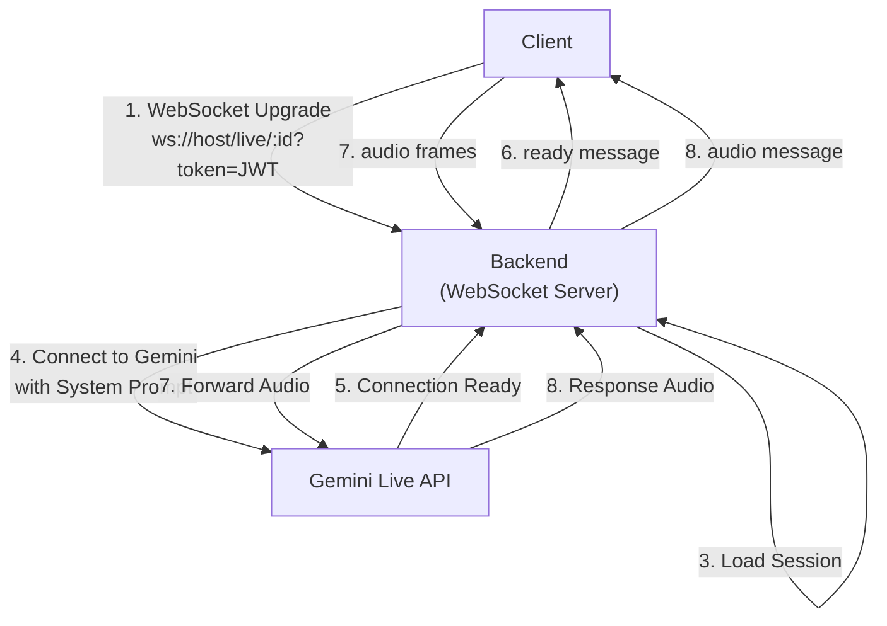
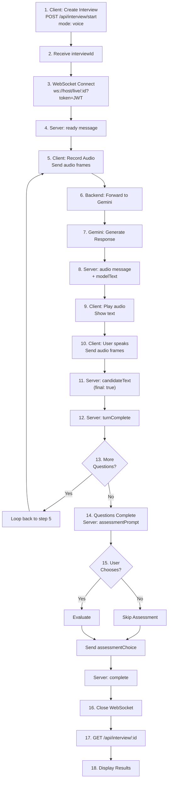

# WebSocket Protocol

This document describes the real-time WebSocket communication protocol used for voice interviews in AI Interviewer.

## Overview

Voice interviews use **WebSocket** for real-time, bidirectional communication between the client and the backend. The backend forwards audio and text data to Google's Gemini Live API and streams responses back to the client.

**Use case**: Text interviews use REST API (see [API.md](./API.md)). Voice interviews use WebSocket for low-latency audio streaming.

## Connection

### URL Format

```
ws://localhost:3000/live/:interviewId?token=<JWT_TOKEN>
```

Or for production:
```
wss://api.example.com/live/:interviewId?token=<JWT_TOKEN>
```

### URL Parameters

| Parameter | Type | Required | Description |
|-----------|------|----------|-------------|
| `:interviewId` | string (UUID) | Yes | Interview ID from `POST /api/interview/start` response |
| `token` | string (JWT) | Yes | Authenticated JWT token (via query string) |

### Connection Flow



### Authentication

The JWT token **must** be included in the query string:

```javascript
const token = localStorage.getItem('token'); // From login
const ws = new WebSocket(`ws://localhost:3000/live/interview-id-123?token=${token}`);
```

**Important**: 
- Token is verified before upgrading to WebSocket
- Invalid or missing token results in immediate connection rejection (socket destroyed)
- Token must match the authenticated user making the request

### Connection Errors

| Condition | Response | Status |
|-----------|----------|--------|
| Invalid/missing JWT | Socket destroyed | Connection refused |
| Interview not found | Error message `type: "error"` | 1000 (Normal closure) |
| Interview already complete | Error message `type: "error"` | 1000 (Normal closure) |
| Interview not configured for voice | Error message `type: "error"` | 1000 (Normal closure) |
| Gemini Live API unavailable | Error message `type: "error"` | 1000 (Normal closure) |

**Example error response**:
```json
{
  "type": "error",
  "message": "The AI voice session could not start. Please try text mode."
}
```

## Message Format

All messages are **JSON objects** with a required `type` field:

```json
{
  "type": "audio",
  "data": "base64-encoded-pcm-data",
  "mimeType": "audio/pcm;rate=24000"
}
```

## Audio Format

### PCM Specification

The system uses **PCM (Pulse Code Modulation)** audio format:

| Property | Value | Description |
|----------|-------|-------------|
| **Encoding** | 16-bit signed PCM | Standard audio format |
| **Sample Rate** | 24000 Hz (24 kHz) | 24000 samples per second |
| **Channels** | Mono (1) | Single audio channel |
| **Byte Order** | Little-endian | Standard for PCM |
| **MIME Type** | `audio/pcm;rate=24000` | Format identifier |

### Audio Transmission

- Client sends PCM audio in **base64-encoded** format
- Backend decodes base64 and forwards raw PCM bytes to Gemini
- Gemini responses are received as base64-encoded PCM
- Backend forwards responses to client in base64
- Client decodes base64 and plays PCM audio

**Buffer size recommendation**: 4096 bytes of PCM (~85ms at 24kHz)

## Client → Server Messages

Messages sent from the browser client to the backend.

### audio

Send PCM audio data to the interview.

**Format**:
```json
{
  "type": "audio",
  "data": "//NCgCbAEBQAAB...",
  "sampleRate": 24000
}
```

**Fields**:
- `type` (string, required): `"audio"`
- `data` (string, required): Base64-encoded PCM audio chunk
- `sampleRate` (number, optional): Sample rate in Hz (default: 16000)

**Notes**:
- Send audio continuously while user is speaking
- Buffer audio into ~4096-byte chunks for smooth streaming
- Include `sampleRate` if different from default
- Server expects 24000 Hz when configured with `GEMINI_LIVE_MODEL`

**Example**:
```javascript
const pcmData = recordAudioBuffer(); // 4096 bytes of PCM
const base64 = btoa(String.fromCharCode.apply(null, new Uint8Array(pcmData)));
ws.send(JSON.stringify({
  type: 'audio',
  data: base64,
  sampleRate: 24000
}));
```

### audioEnd

Signal end of audio stream (user stopped speaking).

**Format**:
```json
{
  "type": "audioEnd"
}
```

**Notes**:
- Sent when user stops recording
- Tells Gemini to process final audio buffer
- Backend forwards to `s.sendRealtimeInput({ audioStreamEnd: true })`
- Optional; Gemini also detects silence automatically (configured by `GEMINI_LIVE_SILENCE_MS`)

### text

Send text input instead of audio (alternative input method).

**Format**:
```json
{
  "type": "text",
  "text": "Here is my answer to the question..."
}
```

**Fields**:
- `type` (string, required): `"text"`
- `text` (string, required): User's text input (trimmed)

**Notes**:
- Currently not widely used (voice interviews focus on audio)
- Forwarded to Gemini as text input
- Server trims whitespace before forwarding

### ping

Keep-alive message to prevent connection timeout.

**Format**:
```json
{
  "type": "ping"
}
```

**Response**: Server responds with `{ "type": "pong" }`

**Notes**:
- Optional but recommended for long silences
- Prevents proxy/firewall timeout
- Send every 30-60 seconds during inactive periods

### assessmentChoice

Submit user's choice on the assessment prompt (continue or finalize).

**Format**:
```json
{
  "type": "assessmentChoice",
  "value": "yes"
}
```

**Fields**:
- `type` (string, required): `"assessmentChoice"`
- `value` (string, required): `"yes"` or `"no"`

**Notes**:
- Sent after `type: "assessmentPrompt"` message received
- `"yes"` = Proceed with evaluation
- `"no"` = Skip evaluation and close
- Triggers interview completion

---

## Server → Client Messages

Messages sent from the backend to the browser client.

### ready

Interview session is ready to start.

**Format**:
```json
{
  "type": "ready",
  "startedAt": "2024-01-15T10:30:00.000Z",
  "position": "Software Engineer",
  "questionCount": 5
}
```

**Fields**:
- `type` (string): `"ready"`
- `startedAt` (ISO string): Interview start timestamp
- `position` (string): Job position for the interview
- `questionCount` (number): Total questions planned

**Sent**: After Gemini Live session connects successfully

**Action**: Client can begin recording and sending audio

### audio

Response audio from Gemini.

**Format**:
```json
{
  "type": "audio",
  "data": "//NCgCbAEBQAAB...",
  "mimeType": "audio/pcm;rate=24000"
}
```

**Fields**:
- `type` (string): `"audio"`
- `data` (string): Base64-encoded PCM audio
- `mimeType` (string): MIME type (always `audio/pcm;rate=24000`)

**Sent**: When Gemini sends audio response

**Action**: Client decodes base64 and plays PCM audio

### modelText

Transcript of Gemini's speech (intermediate or final).

**Format (Intermediate)**:
```json
{
  "type": "modelText",
  "text": "Tell me about your...",
  "final": false
}
```

**Format (Final)**:
```json
{
  "type": "modelText",
  "text": "Tell me about your most recent project and the challenges you faced.",
  "final": true
}
```

**Fields**:
- `type` (string): `"modelText"`
- `text` (string): Transcribed text (may be partial if `final: false`)
- `final` (boolean): `true` if transcription is complete

**Sent**: Continuously as Gemini speaks, then final version when done

**Action**: Display text to user for clarity. Show final version when `final: true`

### candidateText

Transcript of user's speech (intermediate or final).

**Format (Intermediate)**:
```json
{
  "type": "candidateText",
  "text": "My most recent project was a real-time...",
  "final": false
}
```

**Format (Final)**:
```json
{
  "type": "candidateText",
  "text": "My most recent project was a real-time dashboard using React and WebSockets.",
  "final": true
}
```

**Fields**:
- `type` (string): `"candidateText"`
- `text` (string): Transcribed speech (accumulated)
- `final` (boolean): `true` when speech is finished

**Sent**: While and after user speaks (updated as Gemini transcribes)

**Action**: Display to user as they speak. Hide when `final: true`

### turnComplete

Current question/turn is complete. Ready for next response.

**Format**:
```json
{
  "type": "turnComplete",
  "questionNumber": 2
}
```

**Fields**:
- `type` (string): `"turnComplete"`
- `questionNumber` (number): Question number (1-indexed)

**Sent**: After Gemini finishes speaking and question is recorded

**Action**: Can update UI to show current question number

### interrupted

Gemini's response was interrupted (user spoke over interviewer).

**Format**:
```json
{
  "type": "interrupted"
}
```

**Fields**:
- `type` (string): `"interrupted"`

**Sent**: When user speaks while Gemini is talking

**Action**: May show visual indicator that response was interrupted

### assessmentPrompt

Interview is complete. Ask user if they want evaluation.

**Format**:
```json
{
  "type": "assessmentPrompt",
  "questionCount": 5
}
```

**Fields**:
- `type` (string): `"assessmentPrompt"`
- `questionCount` (number): Total questions asked

**Sent**: When interview reaches completion condition

**Action**: Show prompt to user: "Interview complete. Would you like an assessment?" 
- If yes: Send `{ "type": "assessmentChoice", "value": "yes" }`
- If no: Send `{ "type": "assessmentChoice", "value": "no" }`

### complete

Interview is finalized and results are ready.

**Format**:
```json
{
  "type": "complete",
  "questionCount": 5
}
```

**Fields**:
- `type` (string): `"complete"`
- `questionCount` (number): Total questions in interview

**Sent**: After evaluation is complete (if requested)

**Action**: 
- Close WebSocket
- Fetch results from `GET /api/interview/:id`
- Display results page with scores

### generationComplete

Gemini finished generating response (for internal flow).

**Format**:
```json
{
  "type": "generationComplete"
}
```

**Notes**: Informational, may not require UI action

### error

Error occurred during interview.

**Format**:
```json
{
  "type": "error",
  "message": "The voice connection failed. Please try text mode."
}
```

**Fields**:
- `type` (string): `"error"`
- `message` (string): Error description

**Sent**: When error occurs

**Action**: Display error to user. May suggest fallback to text mode

### closed

Connection closed unexpectedly.

**Format**:
```json
{
  "type": "closed",
  "reason": "The voice connection was closed."
}
```

**Fields**:
- `type` (string): `"closed"`
- `reason` (string): Closure reason

**Sent**: When Gemini connection closes unexpectedly

**Action**: Attempt reconnection or fallback to text mode

### pong

Response to keep-alive ping.

**Format**:
```json
{
  "type": "pong"
}
```

**Sent**: In response to client's `{ "type": "ping" }`

---

## Interview Lifecycle

### Complete Voice Interview Flow



## Error Handling

### Connection Errors

```javascript
const ws = new WebSocket(`ws://localhost:3000/live/${interviewId}?token=${token}`);

ws.addEventListener('error', (event) => {
  console.error('WebSocket error:', event);
  // Fallback to text mode or retry
});

ws.addEventListener('close', (event) => {
  if (event.code !== 1000) {
    console.error('Unexpected close:', event.code, event.reason);
    // Unexpected closure - may retry or show error
  }
});
```

### Application-Level Errors

Listen for `error` messages from server:

```javascript
ws.addEventListener('message', (event) => {
  const msg = JSON.parse(event.data);
  
  if (msg.type === 'error') {
    console.error('Interview error:', msg.message);
    // May show user error and offer fallback
  }
});
```

## Audio Streaming Example

### Recording and Sending

```javascript
// Assuming MediaRecorder or Web Audio API
const recorder = new MediaRecorder(audioStream);
const audioChunks = [];

recorder.addEventListener('dataavailable', (event) => {
  audioChunks.push(event.data);
  
  // Convert to PCM and send
  const arrayBuffer = await event.data.arrayBuffer();
  const pcmBase64 = btoa(String.fromCharCode.apply(null, new Uint8Array(arrayBuffer)));
  
  ws.send(JSON.stringify({
    type: 'audio',
    data: pcmBase64,
    sampleRate: 24000
  }));
});

recorder.start();
```

### Receiving and Playing

```javascript
ws.addEventListener('message', (event) => {
  const msg = JSON.parse(event.data);
  
  if (msg.type === 'audio') {
    // Decode base64 PCM
    const binaryString = atob(msg.data);
    const bytes = new Uint8Array(binaryString.length);
    for (let i = 0; i < binaryString.length; i++) {
      bytes[i] = binaryString.charCodeAt(i);
    }
    
    // Play audio using Web Audio API
    const audioContext = new AudioContext();
    const audioBuffer = audioContext.createBuffer(
      1, // mono
      bytes.length / 2, // sample count (16-bit = 2 bytes per sample)
      24000 // sample rate
    );
    
    const channelData = audioBuffer.getChannelData(0);
    const view = new DataView(bytes.buffer);
    for (let i = 0; i < audioBuffer.length; i++) {
      channelData[i] = view.getInt16(i * 2, true) / 32768;
    }
    
    const source = audioContext.createBufferSource();
    source.buffer = audioBuffer;
    source.connect(audioContext.destination);
    source.start(0);
  }
});
```

## Rate Limiting

WebSocket connections are subject to the same rate limits as REST endpoints:

- **Global**: 100 requests per 15 minutes per IP
- **Answer submission**: 30 per minute per IP

Rate limit applies to incoming messages (`audio`, `text`, etc.), not audio frame frequency.

## Connection Timeout

- **Idle timeout**: ~5-10 minutes (proxy/firewall dependent)
- **Keep-alive**: Send `{ "type": "ping" }` every 30-60 seconds during silence
- **Maximum interview duration**: No hard limit, but recommend <1 hour total

## Scaling & Load Balancing

### Sticky Sessions Required

WebSocket connections are **stateful**. Load balancers must use **sticky sessions** (also called session affinity):

```nginx
# nginx example: stick to same upstream server
upstream backend {
  server backend1.example.com weight=1;
  server backend2.example.com weight=1;
  hash $remote_addr;  # Sticky sessions by IP
}
```

### Connection State

- Each interview session is tied to a backend instance
- Session data is stored in memory and persisted to MongoDB on message completion
- If backend instance crashes, connection is lost (user must reconnect)

### Horizontal Scaling

To scale voice interviews:

1. Use sticky sessions/consistent hashing
2. Ensure MongoDB is shared across instances
3. Implement session replication or Redis-backed state for high availability
4. Monitor Gemini API quota across all instances

## Security Considerations

1. **Token in Query String**: JWT is visible in URL. Use HTTPS (WSS) in production.
2. **No Rate Limit Bypass**: WebSocket messages are rate-limited like REST.
3. **Input Validation**: All incoming messages are validated server-side.
4. **Audio Data**: Is forwarded directly to Gemini; ensure privacy policy addresses this.

## Debugging

### Browser DevTools

1. Open DevTools → Network tab
2. Filter by "WS" (WebSocket)
3. Click `/live/...` connection
4. View "Messages" to see all JSON exchanges
5. Check frame sizes and frequency

### Backend Logs

```bash
# Watch backend logs during WebSocket session
npm run dev:backend

# Look for logs like:
# [INTERVIEW] Started new session: ...
# [SESSION] Interview automatically completing...
# [ASSESSMENT] Generating assessment...
```

### Common Issues

| Issue | Cause | Solution |
|-------|-------|----------|
| Connection rejected | Invalid JWT | Verify token from login response |
| "No live-capable model" | `GEMINI_LIVE_MODEL` not set | Configure in `.env` |
| Audio not playing | PCM decoding error | Check sample rate matches (24000) |
| "Connection closed" | Backend crashed | Reconnect with new session |
| Messages not received | Client not listening to 'message' event | Add `ws.addEventListener('message', ...)` |

---

# Integration Checklist

For implementing voice interviews:

- [ ] Create interview via `POST /api/interview/start` with `mode: "voice"`
- [ ] Store returned `interviewId` and JWT `token`
- [ ] Establish WebSocket: `new WebSocket(ws://host/live/${id}?token=${token})`
- [ ] Listen for `type: "ready"` before starting audio
- [ ] Request microphone permission from user
- [ ] Record audio in 24000 Hz PCM format
- [ ] Send audio frames as base64 in `{ type: "audio", data: "..." }` messages
- [ ] Listen for `type: "audio"` and play responses
- [ ] Display `type: "modelText"` and `type: "candidateText"` for clarity
- [ ] Handle `type: "complete"` to close WebSocket
- [ ] Fetch final results via `GET /api/interview/:id`
- [ ] Handle errors and offer fallback to text mode
